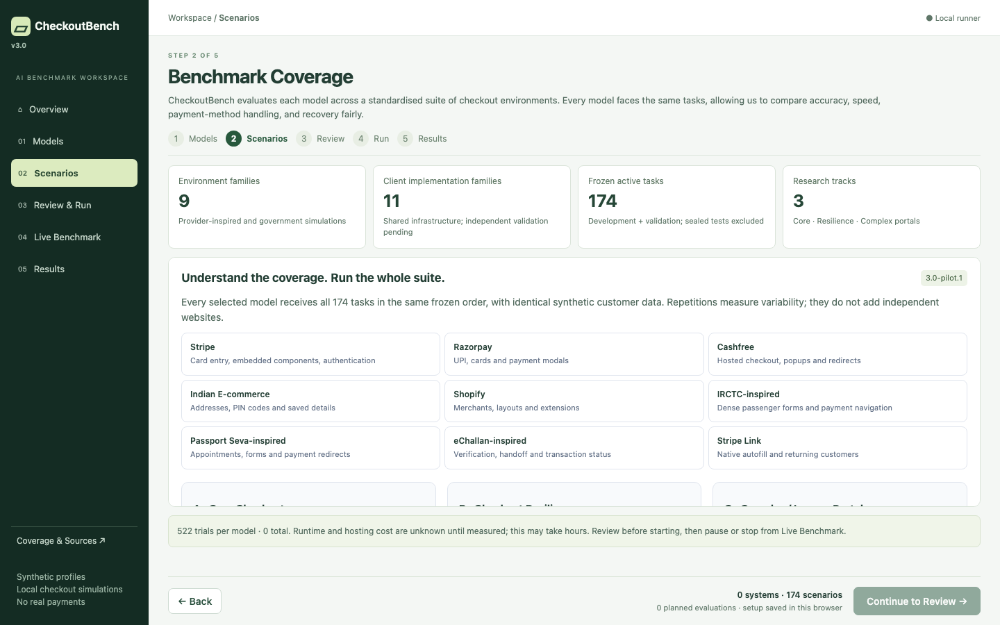

# CheckoutBench 3.0

A local research workbench for evaluating lightweight checkout specialists. **Select Models → Understand Benchmark Coverage → Review → Run All → Analyse Results.**

Research release **3.0-pilot.1** adds 174 active tasks across nine environment families and three research tracks. The dashboard is version 3.0.0; the compatible fixture engine remains 2.1. Obsolete validation records are preserved in a verified local archive; the active results database starts empty.

**Publication status: NOT READY.** Independent ground-truth review, genuinely unseen independent holdouts, adequate independent implementations, remaining checkpoint verification and official sandbox validation are still required. [Read the limitations](docs/research/LIMITATIONS.md). Software regression success is not evidence of model capability or scientific validity.

All checkout/payment interactions are synthetic. A prepared checkout, displayed QR, safe abort or authorisation handoff is not a completed financial transaction.



## Start locally

Requires Python 3.12+, Node 22+, uv and Chromium:

```sh
uv sync --python 3.12 --extra test --extra agent
.venv/bin/playwright install chromium
npm --prefix frontend ci
npm --prefix frontend run build
./scripts/start.sh
```

Open [CheckoutBench](http://127.0.0.1:8000). The isolated fixture server uses port 8001. Restart after backend/environment changes; rebuild after frontend changes. Keep credentials and local model paths in the ignored `.env` file. Never overwrite an existing `.env` to add one setting.

## Unified official results

CheckoutBench displays one unified set of results from the current official benchmark release. Internal software validation is separate from genuine AI model evaluations.

The active frozen manifest and an explicitly configured official evaluation protocol determine eligibility. Without that configuration or eligible runs, Results shows **No benchmark results yet**. No record is chosen implicitly to define the protocol. Configure the intended settings and verified checkpoint identities before evaluation using the [operator instructions](docs/operations/RESULTS_DATASET.md).

Reference/debug runs and test doubles use separate validation storage. Genuine verified experiment attempts—including failures, timeouts and blocked attempts—are preserved. Incompatible experiments remain internally inspectable without being combined in official statistics. Future releases do not delete prior evidence. See the [one-time cleanup audit](docs/operations/RESULTS_CLEANUP_AUDIT.md) and [backup/migration guidance](docs/operations/RESULTS_DATASET.md#one-time-cleanup-and-future-migrations).

## Run a benchmark

1. **Models:** choose among the five specialists below. Availability alone does not prove checkpoint identity or inference. Research runs require exact local checkpoint verification and a real smoke test.
2. **Benchmark Coverage:** understand the three tracks and nine environments. Every model runs the entire frozen development/validation manifest. There are no per-scenario selectors in ordinary setup.
3. **Review:** confirm total trials, repetitions, action/token/time limits and recording. Seed/profile/suite are fixed. Unknown inference/hosting cost is not zero. Large batches may take hours. Repetition counts are pilot choices, not final-study power estimates.
4. **Run All:** start only after explicit confirmation. Pause/resume/stop retain recorded attempts. No automatic model run occurs on refresh.
5. **Results:** Summary, Model Comparison, Scenario Analysis, **Payment & Stage Analysis**, Run Explorer. The new tab has payment rankings, branching stage funnel, failure drilldowns and vendor × method matrix. Insufficient evidence never generates a winner. Every tab uses the same current official dataset; version/protocol/cohort selectors are absent.

| Configuration | Parameters | Learned contribution / assistance |
|---|---:|---|
| CUA-S1-Forms + Playwright | 706,048 | Field/entity scoring; DOM execution and controller navigation |
| TinyClick + deterministic controller | 270M advertised | Visual coordinates; deterministic target/value planning |
| CUA-S1 + TinyClick | ~270.7M combined | Both semantic and grounding inference; controller navigation |
| MAI-UI-2B | 2B | Screenshot-based actions executed by the browser |
| UI-Venus-1.5-2B | 2B | Native visual action grammar executed by the browser |

Playwright is browser infrastructure, not an AI model. CUA has passed exact-weight cold/warm inference smoke on the implementation machine; this is not an accuracy result. TinyClick is blocked by missing exact original weights, which also blocks hybrid verification. MAI/UI-Venus provenance is recorded; local inference remains unverified. No model is substituted. Frontier/OpenRouter/direct-provider backends remain available through developer APIs and hidden from normal UI.

See [model cards](docs/research/MODEL_CARDS.md), [specialist setup](docs/SPECIALISTS.md) and [reproduction](docs/research/REPRODUCING.md). Install optional specialist dependencies separately, then configure exact paths and run:

```sh
.venv/bin/python -m scripts.research.verify_models --model cua-s1
.venv/bin/python -m scripts.research.manage readiness
```

## What is measured

- **Core Checkout:** correct preparation of fields, addresses and payment details.
- **Checkout Resilience:** correct resolution of QR/authentication/validation/redirect difficulties, including specified safe stops.
- **Complex / Legacy Portals:** complete resolution of booking, appointment and challan tasks.

Thirteen stages distinguish not applicable, not reached, attempted, completed, failed, recovered, handoff and safe abort. Payment method, details, authentication and final simulated state are separate. QR recovery includes only encountered recoverable QR problems. Successful latency excludes failures; load, inference and browser/controller intervals are separately reported where observable.

The release has **11 client implementation families**, including ten new merchant clients, but they share infrastructure. They are conservatively one statistical independence cluster. Scenario count is not website count; population intervals and reliable best/worst claims are unavailable with inadequate independent coverage.

## Research artifacts

[Readiness](docs/research/READINESS.md) · [Validation](docs/research/VALIDATION.md) · [Audit](docs/research/BENCHMARK_AUDIT.md) · [Methodology](docs/research/METHODOLOGY.md) · [Dataset card](docs/research/DATASET_CARD.md) · [Protocol](docs/research/EVALUATION_PROTOCOL.md) · [Schema](docs/research/RESULTS_SCHEMA.md) · [Licenses](docs/research/LICENSES_AND_ATTRIBUTION.md) · [Changelog](docs/research/CHANGELOG.md)

```sh
.venv/bin/python -m scripts.research.manage review-packet
.venv/bin/python -m scripts.research.manage export --output data/research/export.zip
```

Results also offers **Research bundle ↓**. Bundles include definitions/hashes, implementation sources, checkpoint provenance, per-run results, long-form leaderboards, standalone SVG charts, a research report and X-thread templates. With no eligible real evaluations, graphics are explicitly marked templates. Sealed holdout contents and credentials are excluded.

## Test or start with clean data

```sh
.venv/bin/pytest -q
npm --prefix frontend run build
# Against a running server: deterministic software check only, not AI inference.
.venv/bin/python scripts/check.py --suite 3.0 --repeats 1
# Start a fresh, separate result directory without deleting historical runs:
BENCH_DATA_DIR="$PWD/data/new-study" ./scripts/start.sh
```

Stop the previous server before starting another instance on the same ports. Existing experiment and archive storage remains intact. The regression suite starts separate temporary storage and servers; test doubles and reference records never populate public research rankings.

The deterministic reference policy can fail unfamiliar-label tasks; that measures its own coverage, not fixture solvability. The full pytest suite additionally uses a private test oracle to validate all ten controlled layout cases. Those oracle checks never count as AI evaluations.

Browser harness behavior, trace fields, and single-checkpoint reproduction: [CUA harness guide](docs/operations/CUA_HARNESS.md).
