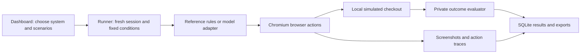
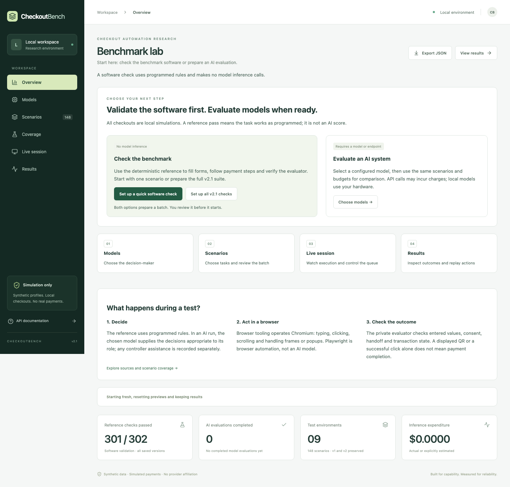

# CheckoutBench 2.1

CheckoutBench is a local browser-automation benchmark for testing checkout software and evaluating AI checkout systems. It includes a React/TypeScript dashboard, FastAPI runner, real Chromium browser execution, private scoring and SQLite results. **All scored checkouts and payments are simulated.** Optional official-sandbox validation is separate and disabled by default.

There are two different uses:

- **Validate the benchmark software:** a deterministic reference controller follows programmed rules. These runs check fixture solvability, scoring, browser behavior and logging without model inference.
- **Evaluate an AI system:** a configured model supplies decisions through its adapter. The runner records model calls, actions, latency, errors and cost separately from deterministic assistance. Only these runs provide model-performance evidence.

The current suite contains **74 v2.1 scenarios across nine environment families**, with 18 v1 and 56 v2 scenarios preserved for historical reference replay. Browser-based flows include merchant forms, hosted payments, embedded components, gateway modals, popups, redirects, QR handoff and fictional authentication. Provider and government interfaces are labelled approximations, with source confidence visible in Coverage.



Playwright launches and operates the browser for reference/specialist paths and test automation. Browser Use provides the API-agent action loop. Neither browser tool is itself an AI model. Private answer keys are used for scoring, not supplied as field mappings to v2.1 models.




## v2.1 integrity and source fidelity

Use **v2.1** for new model comparisons. Its customer task is independent of the private answer key, field IDs are opaque, CUA-selected values drive fills, and TinyClick coordinates drive both field and navigation clicks. The hybrid invokes both models. Wrong semantic choices and wrong clicks are executed and scored; neither is silently corrected. CUA/TinyClick systems still use disclosed deterministic lifecycle assistance and must not be presented as equivalent to fully autonomous agents.

The 74 v2.1 scenarios retain nine environment families and add distinct hosted/embedded/payment-component, modal/popup/redirect, browser-government and merchant-address structures. Desktop/mobile web and supported payment methods are explicit. Native mobile apps are not evaluated. Link uses a US/USD customer and is labelled unavailable in India. QR preparation/handoff is separate from payment completion. Shopify extensions are sandboxed local approximations, not the Shopify SDK.

The Coverage panel shows source URL, source type/date, confidence, fidelity classification, platform and expected outcome. Replay shows action attribution and measured latency intervals. Original v1/v2 definitions and SQLite results are preserved; historical model results are **not comparable** with v2.1. Historical versions remain available for deterministic reference replay. Migrated holdouts are regression cases; freeze a fresh unseen evaluation set before making generalisation claims.

- [Source-to-implementation audit](docs/v2.1/SOURCE_AUDIT.md)
- [Implementation report and evidence](docs/v2.1/IMPLEMENTATION_REPORT.md)
- [Optional official sandbox validation](docs/v2.1/SANDBOX_VALIDATION.md)
- [Screenshot inspection index](docs/v2.1/screenshots/inspection.json)

Validation commands (no paid inference):

```sh
.venv/bin/pytest -q
.venv/bin/python -m scripts.check --suite 2.1 --repeats 1
.venv/bin/python -m scripts.visual_v21
```

A passing reference executor demonstrates fixture solvability, not model capability or research-grade validity. Current authenticated government layouts, real payment SDK behavior and actual specialist performance remain separately qualified in the report.

## Start locally

Requirements: Python 3.12+, Node 22+, `uv`, and a Chromium-compatible machine.

```sh
uv sync --python 3.12 --extra test --extra agent
.venv/bin/playwright install chromium
npm --prefix frontend ci
npm --prefix frontend run build
[ -f .env ] || cp .env.example .env
./scripts/start.sh
```

Open **http://127.0.0.1:8000**. The isolated checkout origin is **http://127.0.0.1:8001**. Both bind only to loopback. The startup command loads `.env`. To rebuild after frontend changes, run `npm --prefix frontend run build` and restart the server. `npm --prefix frontend run dev` provides a Vite development server; use its configured API proxy.

If `uv` encounters an obsolete system interpreter on macOS, use `UV_PYTHON_PREFERENCE=only-managed uv python install 3.12`, then prefix the sync command with `UV_PYTHON_PREFERENCE=only-managed`. If Node reports a certificate-chain error on a managed Mac, use `NODE_EXTRA_CA_CERTS=/etc/ssl/cert.pem npm --prefix frontend ci` when that file contains your trusted CA bundle. Certificate verification remains enabled. The backend uses `SSL_CERT_FILE`, or `/etc/ssl/cert.pem` when available.

## Dashboard guide

| Section | What it does | Typical next step |
| --- | --- | --- |
| **Overview** | Explains the system and offers one-scenario or full-v2.1 software-check presets. Shows reference and AI totals separately. | Prepare a software check, or go to Models. |
| **Models** | Selects the decision-maker; shows availability, missing setup, architecture and API catalogue information. | Choose systems, then select **Next: choose scenarios**. |
| **Scenarios** | Selects tasks, customer, repetitions and limits. Shows a separate interactive practice preview. | Review the batch, then explicitly start it. |
| **Coverage** | Shows source provenance, fidelity limits, author criteria and reference validation status. | Explore a scenario manually or validate one reference path. |
| **Live session** | Shows batch progress, screenshots and action traces; supports pause, resume and stop. | Watch execution or stop the remaining queue. |
| **Results** | Shows saved system results, scenario matrix, run history, replay and JSON/CSV exports. | Filter by version and reference versus AI; inspect failures. |

Result filters apply to the system table, scenario matrix and run history. Overview totals describe all saved versions. Link comparisons have their own equivalent-arm pairing. Exports contain **all saved runs**, regardless of display filters. Matching configurations accumulate across batches in the current results directory.

### First run: check the software without AI

1. Open Overview and choose **Set up a quick software check**, or **Set up all v2.1 checks** for all 74 scenarios.
2. The preset selects only the reference controller, one repetition, seed 2026, 100 maximum actions and a 180-second timeout per trial. It does not start automatically.
3. On Scenarios, inspect the selection and choose **Review & run**.
4. The review identifies the batch as software validation with no model inference. Choose **Start software check**.
5. Follow Live session, then inspect Results. A pass means the programmed fixture path and checks worked; it is not an AI capability score.

To run the same complete reference suite against the running app from another terminal:

```sh
.venv/bin/python -m scripts.check --suite 2.1 --repeats 1
```

### Evaluate actual models

1. Open Models and select one or more configured systems. **Configured** still requires a successful real inference check; **Unavailable** explains what setup is missing.
2. Continue to Scenarios and select v2.1 tasks. Keep the same customer, seed, viewport, action budget and timeout across compared systems.
3. Set repetitions and optional spending cap. Review estimated expenditure, then explicitly start. API model runs may incur charges; local specialists require their actual checkpoints and dependencies.
4. Use Results to compare matched configurations and inspect model-versus-controller attribution. Missing systems are recorded as unavailable rather than silently replaced.

Link's A/B/C arms are optional specialized comparisons; keep **Standard benchmark** for ordinary software checks and model evaluations. New model batches use v2.1. Earlier versions remain available for reference replay.

### Start fresh without deleting history

Each scored trial automatically starts with a **fresh browser profile and checkout session**. Cookies, form entries and prior transaction state do not carry into the next trial.

- **Reset preview** creates a fresh practice checkout only; it does not affect active batches or saved results.
- **Reset setup to one software check** restores the reference selection and default settings, preserving results.
- **Clear selection** deselects scenarios; it does not delete their results.
- **Stop** cancels the current run and remaining queue, retaining recorded evidence.

There is no delete-history button. For an empty results dashboard, stop the batch and wait for it to stop, stop the server with Ctrl+C in its terminal, then start with a new data directory from the repository root:

```sh
BENCH_DATA_DIR="data/suites/$(date +%Y%m%d-%H%M%S)" ./scripts/start.sh
```

Refresh the dashboard. The new folder contains its own SQLite database and artifacts, while `.env`, original results and earlier suites remain untouched. Use a fixed `BENCH_DATA_DIR` path to reopen a particular suite. Stop the server and run `./scripts/start.sh` normally to return to the original `data/` history (or the directory configured in `.env`). Do not delete or move the database while the server is running.

No inference spending cap is imposed by default. The action and timeout limits bound execution. The planning estimate assumes 6,000 input tokens and the full output budget per step; it is explicitly an estimate. If a cap is set, OpenRouter/direct calls reserve a conservative context-window cost ceiling **before** sending each request. Provider-reported cost replaces the reservation; missing usage is estimated and interrupted/uncertain calls retain their reservation. Provider pricing can change, so a provider-side credit limit remains the final billing control. Self-hosted specialist endpoint hosting/GPU costs are outside the API-cost ledger and are marked unreported when no cost is returned. A batch cap blocks remote specialist systems whose billing cannot be bounded; use local inference or an endpoint-side quota.

## Frontier models

Set `OPENROUTER_API_KEY` in `.env` and restart. Keys are used only in the backend and never returned to the dashboard. The application queries `https://openrouter.ai/api/v1/models` and resolves **exact** IDs, prices, modalities and supported parameters at runtime. Refresh the catalogue from the model panel. Missing IDs stay unavailable; no weaker/free model is substituted. Free models may be explicitly added using catalogue search.

The six requested candidates are prelisted: GPT-6 Astra, Sol and Luna; Claude Fable 5.1, Sonnet 5.5 and Haiku 5.5. Browser Use 0.11.13's native `ChatOpenRouter` is used. No planning/judge/fallback model or unmetered extraction LLM is enabled. Browser Use performs actual browser actions, not just API completions. Its file, JavaScript-evaluation and external-navigation tools are removed.

Reasoning controls offer explicit effort values only when the catalogue advertises reasoning support. OpenRouter does not enumerate per-provider effort levels in the models response; individual values are provider-validated. Unsupported settings fail explicitly, with no automatic downgrade. Use a separate batch for a high-capability setting (`high`, or `max` if accepted by that model/provider) and a lower-latency setting. Exact parameters, provider responses, usage and prices are saved with each run.

### Explicit direct-provider adapters

For an OpenAI-compatible provider unavailable through OpenRouter, configure `DIRECT_MODELS_JSON` with an explicit model and provider credential variable. This creates an additional selectable system; it is never an automatic fallback. Example `.env` entry (replace the ID with a model actually accessible to your account):

```dotenv
DIRECT_MODELS_JSON='[{"id":"direct/my-frontier","name":"My direct frontier","model_id":"EXACT_PROVIDER_MODEL_ID","base_url":"https://YOUR_PROVIDER/v1","api_key_env":"DIRECT_PROVIDER_API_KEY","vision":true,"context_length":200000,"reasoning_levels":["low","high"],"token_parameter":"max_tokens","pricing":{"prompt":"0.000005","completion":"0.000015"}}]'
DIRECT_PROVIDER_API_KEY=
```

The endpoint must support chat completions with JSON-schema structured output. Direct pricing/capabilities are operator-supplied, not catalogue-verified. `token_parameter` may be `max_completion_tokens` when required. The direct adapter sends `reasoning_effort`; providers using another protocol need a new typed adapter. Native Anthropic direct API is not bundled. Optional read-only official sandbox routes are documented separately; scored fixtures never use them.

## Specialist systems

See [docs/SPECIALISTS.md](docs/SPECIALISTS.md) for real model inference, exact remote endpoint contracts, checkpoints and hardware requirements.

| Selectable system | Model role | Controller |
| --- | --- | --- |
| CUA-S1 Forms | Field-option scoring, confidence | Generic DOM + Playwright |
| TinyClick | Screenshot coordinate grounding | Generic DOM checkout controller |
| CUA-S1 + TinyClick | Field scoring + coordinate grounding | Shared deterministic controller |
| MAI-UI-2B | Screenshot-driven next action | Native `mobile_use` action parser |
| UI-Venus-1.5-2B | Screenshot-driven next action | Native `<action>…</action>` parser |

Weights are never downloaded on application startup. Missing dependencies, weights, hardware or endpoints produce unavailable runs. Local inference is lazy and uses safetensors. CUA-S1 is not a generative LLM. The requested TinyClick repository currently has no weight files; its example mentions a different repository, which is not silently substituted.

In v2.1, the reference/TinyClick controller uses visible semantics and the independent customer profile. It has no evaluator access. TinyClick-only runs receive deterministic value-selection and workflow assistance; TinyClick supplies screenshot-grounded clicks. CUA-S1 supplies field-value choices, and the hybrid uses both predictions. Deterministic lifecycle actions remain separately attributed. This is a **system comparison**, not evidence that every specialist independently plans an entire checkout. GUI agents receive screenshots, the public task and action history; historical v1/v2 controller behavior is not comparable.

Hardware planning: core reference/browser runs need no GPU; 8 GB system RAM is a practical starting point. CUA-S1 can run on CPU. TinyClick typically needs several GB of working memory. The 2B GUI systems should be planned around 8–12+ GB GPU/unified memory, depending on image/token budget; CPU fallback is slow. These are estimates, not measured requirements on this machine. CUDA/MPS/CPU detection and dependency state appear in model metadata. A configured model is marked `configured_unverified` until real inference succeeds. Local cancellation cannot forcibly interrupt a PyTorch kernel already executing; bounded generation may finish in its worker thread after Stop.

## Environments and scenarios

The four preserved v1 visual environments draw on public checkout interaction patterns without copying provider code/assets or implying affiliation:

- **Paper & Form / Stripe-inspired:** contact/shipping, billing toggle, embedded card iframe, simulated 3DS preparation and validation recovery.
- **Northstar / Razorpay-inspired:** PhonePe, Google Pay, Paytm and BHIM, app switching, non-scannable QR preparation, card and legacy dummy VPA.
- **Kinship / Cashfree-inspired:** hosted layout, modal checkout, failure/retry and local mock-bank handoff with pending state.
- **The Good Store / generic Indian commerce:** dependent city choices, address suggestions, editable wrong saved address, delivery instructions and distracting fields.

| ID | Challenge |
| --- | --- |
| T01 | Standard delivery + PhonePe |
| T02 | Unfamiliar labels |
| T03 | Empty optional Address Line 2 |
| T04 | State/city dependency |
| T05 | Address autocomplete |
| T06 | Separate shipping and billing |
| T07 | Wrong prefilled details |
| T08 | PhonePe when card is preselected |
| T09 | Google Pay among four apps |
| T10 | Non-scannable QR preparation |
| T11 | Legacy synthetic UPI VPA |
| T12 | Card iframe |
| T13 | Card error then recovery |
| T14 | Modal failure then retry |
| T15 | Synonyms, distracting fields, searchable state, delayed rendering, switching |
| H01 | Holdout: unfamiliar separate billing + card |
| H02 | Holdout: redirected QR retry |
| H03 | Holdout: unfamiliar saved delivery + BHIM |

Definitions in `scenarios/catalog.py` include initial state, expected synthetic profile, target payment, required/optional fields, allowed actions, success conditions, seed and timeout. Holdouts are tagged and excluded from the default **All core** selector; no specialist model is trained here. Labels are selected deterministically from the seed. Model sampling itself is not promised deterministic.

## Evaluation and security boundary

Checkout business validation checks formats, required fields and allowed test-payment data. It does **not** compare addresses to hidden profiles. The private evaluator independently checks required-field exactness (with whitespace/case/phone normalization), optional empty-or-correct handling, requested payment/app, test-card details and the authorisation-ready stage. A plausible but wrong address may reach the UI's ready screen and still score as a benchmark failure.

Empty Address Line 2 never blocks or lowers a score. If supplied, it must match the profile's optional value. The original `index.html` bug is fixed and regression-tested. That legacy page still contains its old client-side fixture and is retained only for regression/reference; the benchmark does not serve or run it.

The control API and checkout have different loopback ports. The agent's browser route policy permits only its opaque session URL, that session's submit endpoints, and the allowlisted fixture assets. Other sessions, the dashboard, model catalogue, results, arbitrary loopback ports, external websites and WebSockets are blocked. CSP also restricts fixture resources to the local origin. Neither expected customer data nor scoring results are returned by the fixture configuration. This is a controlled benchmark boundary, not a hardened isolation system for hostile code with operating-system access.

Only synthetic test-card and VPA inputs are accepted. V1 stops at authorisation preparation. V2 adds real QR images containing nonpayable `.invalid` URLs and fictional OTP/approval flows through a separate test-user simulator. Neither version sends banking requests or accepts a real UPI PIN.

## Persistence, statistics and exports

`data/results.sqlite3` stores complete run records. `data/<run-id>/` stores step screenshots, an action JSON file and optional WebM video. API keys are never recorded. All visible personal values are fictional. Restarted active runs are marked blocked; completed results survive restarts. Queue resumption after process restart is not implemented.

Leaderboard ordering: success rate, Wilson 95% lower confidence bound, median successful duration, mean actions, cost per success. Cohort hashes include the selected scenario set, seed, profile, repeats and configuration, so unequal test conditions are not pooled. Reference systems are visibly labeled. Wilson intervals, duration standard deviation, recovery/holdout success and scenario counts are available in the API. With few trials, intervals are wide; no statistical superiority is claimed automatically.

Wall time includes setup and capture overhead. Inference time is measured separately. The `browser_interaction_seconds` field is explicitly marked as wall-minus-inference, including controller/setup overhead; it is **not pure browser CPU time**. Local loading time may be included in first inference. Each configuration gets fresh model adapters; no warm-cache latency claim is made.

```sh
curl http://127.0.0.1:8000/api/export/json -o benchmark.json
curl http://127.0.0.1:8000/api/export/csv -o benchmark.csv
.venv/bin/python scripts/check.py --repeats 3
```

Exports retain conditions and exact configuration. They are deterministic snapshots while no run is changing. Action replays are screenshots, not re-execution of recorded transactions.

## Tests

The full software suite requires no paid inference. It combines unit tests, real-browser reference paths and deliberately wrong model-response test doubles. It checks fixture workflows, scoring, isolation, authentication/QR handoff, model action contracts, guided dashboard setup and result filters. Test doubles establish integration behavior, not model quality.

[Dashboard update and validation evidence](docs/ui/IMPLEMENTATION_REPORT.md) includes desktop/mobile captures and the latest complete regression result.

```sh
.venv/bin/pytest -q
npm --prefix frontend run build
```

Tests start separate servers on 8765/8766 and use temporary SQLite/artifact directories. The v1 tests cover all 18 original scenarios with browser execution and video; v2 adds its complete reference suite and negative controls. Other checks include the original optional-field regression, partial/wrong scoring, dependent controls, iframe/retry transitions, unavailable classification, exact network allowlisting, hidden-metadata isolation, cost reservations/reconciliation, strict specialist parsers, pause/resume/stop, exports, and a **scripted-response** native Browser Use action in real Chromium. Mocked adapter tests are not benchmark model results. A genuinely paid or weights-backed run requires your credentials/checkpoints.

See [docs/IMPLEMENTATION_REPORT.md](docs/IMPLEMENTATION_REPORT.md), [docs/RESEARCH.md](docs/RESEARCH.md), and [docs/SPECIALISTS.md](docs/SPECIALISTS.md).

## Layout

```text
frontend/              React dashboard, Vite, TypeScript
checkout_fixtures/     Local HTML/CSS/JS checkouts + card iframe
scenarios/             Private seeded definitions and synthetic profiles
backend/adapters/      Native OpenRouter/direct and specialist inference
backend/browser/       Generic execution, extraction and allowlist
backend/evaluator/     Programmatic private scoring
backend/runner/        Sequential batches, cancellation and captures
backend/storage/       SQLite and reliability aggregation
backend/fixtures.py    Isolated checkout HTTP surface
backend/app.py         Control API, SSE and dashboard
scripts/               Startup and repeatable reference verification
tests/                 pytest + actual Playwright/Browser Use execution
```

Private GitHub repository: [devatreya/checkoutbench](https://github.com/devatreya/checkoutbench). Runtime data, environment files and installed dependencies are excluded from Git.

## CheckoutBench v2.0

The v1 T01–T15 and H01–H03 definitions and historical results are preserved. V2 adds 48 core scenarios and eight holdouts (74 scenarios total), with nine environment families. `S01–S12` cover six fictional Shopify-style merchants, `R01–R06` railway booking, `P01–P04` appointment payment, `E01–E04` challans, `L01–L09` plus paired `L06H` Link flows, `Q00–Q05` QR quality, and `A01–A06` authentication. `V2H01–V2H08` are infrastructure-validated holdouts, not training examples.

Open **Coverage** to inspect the family/variant matrix, select a scenario, read the task and private author criteria, interact with its preview, change the seed, reset, or run a reference execution. **Scenarios** has version and family filters for model runs. V2 viewports are scenario-specific (desktop 1280×900 or mobile 390×844) and identical across models on that scenario. Models still run sequentially. **Results** separates benchmark versions and experimental arms; combined views label each row instead of pooling v1 and v2.

### Link comparison

Select only Link scenarios and choose **Paired A / B / C Link comparison**. The runner executes a native-Link scripted test user (A), each selected agent without Link (B), and with Link (C), sequentially using equivalent profiles, seeds and limits. You can also run arms individually. Reference in B/C validates the experiment without paid inference; it is not an AI result. Native stale billing intentionally fails in A. `L09` is the explicit registration-consent case; every other Link task prohibits enrolment.

The separate comparison table reports matched success differences and user-action savings only when corresponding runs exist. Native autofill is recorded separately. Link scenarios represent a US/USD card-funding configuration and expose no UPI wallet functionality. These are original local Link simulations, not Stripe Payment Links and not an actual Stripe sandbox integration.

### Authentication and QR

`backend/authentication.py` provides seeded four-/six-digit OTPs, expiry, resend, invalid/locked/delayed states and separate test-user approval. Agents request authorisation through the page. In **handoff** mode they must explicitly report the handoff and stop. In **simulated_completion** mode a runner-owned test user approves the synthetic challenge; the agent waits and resumes. The test-user function operates outside the browser and never exposes the code to the agent origin. In a manual Coverage preview, click **Provide requested test-user approval** after requesting approval inside the checkout. Invalid/expired challenges require resend first. Modal, iframe, popup and redirect surfaces share this simulator. Mock CAPTCHA always requires intervention.

`backend/qr.py` uses `qrcode` to generate images and `zxing-cpp` to independently decode them. Payloads use reserved `.invalid` URLs, never payable UPI URIs. Quality presets cover clean, small, blurred, compressed, obscured and expired codes. `QRConfig` exposes size, density, contrast, blur, JPEG quality, crop, quiet zone, error correction, expiration and appearance delay. Identical seeds generate identical images across fresh sessions. Display enlargement does not restore lost information or automatically earn success; the evaluator checks actual decoder output and expiration. Expected payloads and decoding reports stay on the server.

### Outcomes and evidence

V2 distinguishes `checkout_ready`, `authentication_required`, simulated authentication events, `payment_successful_simulation`, pending/failed workflow states and `safe_abort`. A safe abort only succeeds where a real blocking condition was encountered; reporting one prematurely fails. Fields, selected payment, consent, transaction count and requested outcome are independently checked. Scenario metadata, per-stage checks, QR reports, native autofill counts, user handoffs and recovery events are included in run JSON and replay artifacts. The error-detection timing metric is a behavioural proxy (error display to recovery action).

Dependencies are locked in `uv.lock`; the normal installation includes the two lightweight QR libraries. Existing OpenRouter, Browser Use, direct-provider and specialist integrations are retained. Specialist weights remain separately configured; no model weights or paid evaluations are needed to validate fixtures. The SQLite JSON schema is additive: old records are read as v1 without rewriting their stored data.

Research provenance and limitations: [v2 research](docs/v2/RESEARCH.md). Plan and audit: [implementation plan](docs/v2/PLAN.md). Optional real Shopify development-store/Bogus Gateway, official Stripe sandbox and live government workflows are **not enabled**. Local test sessions remain restricted to their own fixture origin and allowlisted per-session paths.

Validation and delivered scope: [v2 implementation report](docs/v2/IMPLEMENTATION_REPORT.md), [reference evidence](docs/v2/reference-verification.json), and [visual inspection evidence](docs/v2/screenshots/inspection.json).
