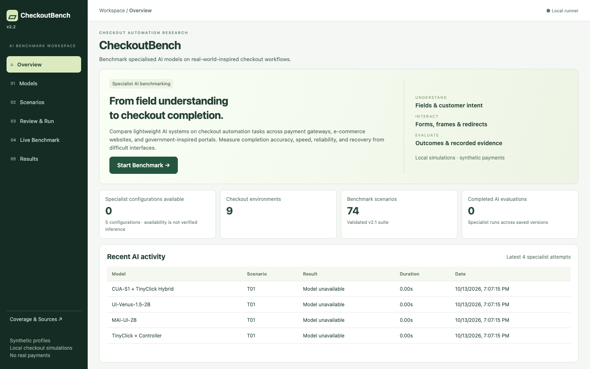
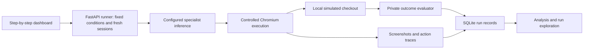

# CheckoutBench 2.2

Benchmark specialised AI models on real-world-inspired checkout workflows. Compare lightweight systems across payment gateways, e-commerce websites and government-inspired portals, measuring completion accuracy, speed, reliability and recovery from difficult interfaces.

The v2.2 dashboard provides one step per page:

**Overview → Models → Scenarios → Review & Run → Live Benchmark → Results**

It uses the existing **74-scenario v2.1 benchmark** across nine environment families. This release changes the interface, not the benchmark engine, fixtures, model adapters or scoring. Historical v1/v2 scenarios and saved results remain intact.

**All scored checkouts, authentication and payments are simulated.** Checkout-ready or authentication-handoff success is not a completed financial transaction. No real OTP, UPI PIN or payable QR is used.



## Start locally

Requirements: Python 3.12+, Node 22+, `uv`, and a machine that can run Chromium.

```sh
uv sync --python 3.12 --extra test --extra agent
.venv/bin/playwright install chromium
npm --prefix frontend ci
npm --prefix frontend run build
./scripts/start.sh
```

Open [CheckoutBench](http://127.0.0.1:8000). The dashboard/control API uses port 8000; isolated checkout fixtures use 8001. Keep the terminal running. After frontend changes, rebuild and refresh. After changing backend environment configuration, stop the server with Ctrl+C and run `./scripts/start.sh` again.

Keep credentials and checkpoint paths in your local, ignored `.env` file. Do not overwrite an existing `.env`. Weights and model servers are not installed or launched by the startup script.

## Run your first AI benchmark

| Page | What it does | Next action |
| --- | --- | --- |
| **Overview** | Shows specialist configuration availability, environment/scenario counts and recent AI runs. | **Start Benchmark →** |
| **Models** | Selects systems and explains their roles, sizes, inference backends and missing setup. | **Continue to Scenarios →** |
| **Scenarios** | Selects tasks using environment cards, filters and separate checkout previews. | **Continue to Review →** |
| **Review & Run** | Reviews the experiment and configures repetitions, profile, limits and advanced settings. | **Start Benchmark →**, then confirm |
| **Live Benchmark** | Shows screenshots, actions, timing, status and batch progress. Supports pause, resume and stop. | **View Results →** |
| **Results** | Analyses comparable trials and opens individual runs with recorded evidence. | Inspect or export results |

**Coverage & Sources** is a secondary research page for source confidence, fidelity limitations, supported payment methods and scenario details.

1. Select one or more configured specialists. **Configured · unverified** means configuration exists, not that inference has succeeded. An unavailable model explains the missing dependency, checkpoint or endpoint. No model is silently substituted.
2. Choose v2.1 scenarios. Start with **Quick benchmark · 5**, select individual tasks, an environment, all core cases or the full suite. Filters cover environment, difficulty, payment, core/holdout/stress cases, QR/authentication and desktop/mobile web. Historical suites are available in advanced browsing but cannot start new AI batches.
3. Preview a scenario to inspect its actual local checkout, synthetic customer, task and success condition. This is an operator-only preview, separate from scored model sessions. It does not start inference or create a scored result.
4. Review repetitions, customer profile, maximum actions and timeout. Advanced settings contain seed, token budget, applicable reasoning, spending cap, recording, infrastructure retries and Link agent arms. Incompatible selections block starting. Costs without reported pricing are **unknown**, not free.
5. Explicitly confirm the start. Selections persist in browser storage and navigation preserves progress. Refreshing does not launch or repeat evaluations.
6. Watch Live Benchmark. Pause acts at the next action boundary; Stop cancels the active run and remaining queue while retaining evidence. Then open Results.

Each scored trial gets a fresh browser profile and checkout session. Comparable experiments should use the same scenarios, customer, seed, repetitions, action/token limits and timeout. Scenario-specific viewports are identical across systems on that task.

## Supported specialist configurations

Only these five configurations appear in the normal dashboard:

| Configuration | Parameters | What the model supplies | Browser/controller role |
| --- | ---: | --- | --- |
| CUA-S1-Forms + Playwright | 706,048 | Semantic field/value choices | Executes chosen values and assists workflow navigation |
| TinyClick + Controller | 270M | Screenshot click coordinates | Selects instructions/values and workflow steps |
| CUA-S1 + TinyClick Hybrid | 270.7M combined | CUA field choices plus TinyClick coordinates | Executes both predictions with disclosed lifecycle assistance |
| MAI-UI-2B | 2B | Screenshot-based next actions | Validates native action format and executes browser actions |
| UI-Venus-1.5-2B | 2B | Multi-step visual GUI actions | Parses native actions and executes them inside the allowed browser surface |

Playwright operates Chromium and captures evidence; it is not an AI model. The hybrid is two specialist models used together, not a separately trained checkpoint. CUA/TinyClick configurations include deterministic assistance and must not be described as fully autonomous agents. Attribution remains visible in recorded actions and run details.

### Configure checkpoints or endpoints

See [Specialist inference setup](docs/SPECIALISTS.md) for dependencies, checkpoint provenance, hardware constraints, exact endpoint contracts and parser limitations.

For local inference, install the optional dependencies and configure audited, absolute checkpoint paths in `.env`:

```sh
uv sync --python 3.12 --extra test --extra agent --extra specialists
```

```dotenv
CUA_S1_MODEL_PATH=/absolute/models/cua-s1-forms
TINYCLICK_MODEL_PATH=/absolute/models/TinyClick
MAI_UI_MODEL_PATH=/absolute/models/MAI-UI-2B
UI_VENUS_MODEL_PATH=/absolute/models/UI-Venus-1.5-2B
```

CUA also requires its upstream `cua_s1` package and validated safetensors checkpoint. TinyClick custom processor/code compatibility must be checked explicitly; the originally requested repository's missing weights are documented in the setup guide. Do not assume these path examples identify installed checkpoints.

Each prefix supports `_DEVICE`, `_ENDPOINT`, optional `_API_KEY` and `_SERVED_MODEL`. Remote endpoints take precedence over local paths. CUA uses the documented `/score` contract, TinyClick `/ground`, and MAI/Venus OpenAI-compatible vision `/chat/completions`. Use a model server port other than the checkout fixture port 8001. Endpoint configuration does not prove successful inference.

No weights-backed specialist evaluation was performed for this UI release. In the validated workspace all five configurations were unavailable until checkpoints/dependencies or endpoints are configured. AI performance summaries remain empty until actual scored specialist runs exist; unavailable attempts remain inspectable.

## Understand and investigate results

Results has four views; only one is displayed at a time:

- **Summary:** checkout success, median time to final outcome, required-field accuracy, method-selection accuracy, scored evaluation count, inference expenditure and a model chart.
- **Model Comparison:** selected systems, Wilson 95% success intervals, timing, field/payment accuracy, recovery and cost per successful checkout. Filter environment, difficulty, payment method, version and execution cohort.
- **Scenario Analysis:** attempts, successes, common failures and median duration by task; open a scenario for its model breakdown.
- **Run Explorer:** search/filter individual records by model, task, status and conditions; open a focused run detail view.

Run Details has six tabs: **Outcome**, **Action timeline**, **Visual replay**, **Fields**, **Payment & authentication**, and **Performance**. Navigate screenshots action by action, inspect model/controller attribution, optional video, recorded fields, payment stages, timings and raw configuration. Screenshot replay displays stored evidence; it does not re-execute actions.

**Metrics Explained** is available in every Results view, including individual runs. Missing instrumentation is labelled **Not reported**, never invented. In particular:

- Existing `payment_accuracy` measures composite payment validation (which can include credentials or authorisation), not isolated payment-method selection. The UI distinguishes them; method-only accuracy stays unreported unless explicitly recorded.
- A false required-field result may mean incorrect or missing. Where the record does not distinguish these, the UI says so. Optional fields marked correct can be empty or correct.
- Median duration includes scored successes and failures. Unavailable, blocked and stopped records remain inspectable but are excluded from scored success-rate denominators.
- Expenditure includes recorded charges on stopped and infrastructure-failed attempts, even though those attempts are excluded from success-rate denominators. Unknown costs do not become zero. Local inference cost does not include electricity/hardware, and remote hosting/GPU charges can be outside the ledger. Cost per success is unreported if there are no successes or costs are incomplete.

Aggregates use a single benchmark version and recorded execution conditions, including the scenario cohort, device, experimental arm, seed and budgets. Unknown conditions are not silently pooled. Cross-version/all-cohort browsing is available in Run Explorer without an aggregate ranking. Comparisons only highlight observed leaders when selected systems have at least five scored trials each and matching scenario/seed/profile/repetition coverage. This minimum is a display safeguard, not a statistical significance test. Best-observed metrics and confidence intervals do not establish an overall winner.

### Exports

| Export | Scope |
| --- | --- |
| Individual run JSON | Original selected run record, unchanged |
| Action trace JSON | Selected run's action and workflow events |
| Filtered run summaries CSV | Current Run Explorer filters, including search/status; all matching pages |
| Filtered comparison CSV | Selected model comparison and its version/cohort/environment filters |
| All specialist results JSON | All saved, frontend-visible specialist records across versions and cohorts, regardless of current filters |

Reference, explicit test-double and frontier records are excluded by the central frontend policy from statistics, searches, live views and all normal UI exports. They remain in storage and developer exports. No UI filter deletes or rewrites records.

## Start a new suite without deleting history

Use **Clear selection** on Scenarios to choose new tasks. Closing and reopening Preview creates a fresh practice session. Changing selections does not erase results; equivalent cohorts can accumulate across batches.

For a completely empty results store, stop any batch, wait for it to stop, stop the server with Ctrl+C, then start from the repository directory with a new data folder:

```sh
BENCH_DATA_DIR="data/suites/$(date +%Y%m%d-%H%M%S)" ./scripts/start.sh
```

Refresh the dashboard. Credentials and earlier results remain intact. Use that same `BENCH_DATA_DIR` to reopen the suite. Stop the server and start normally to return to the original history. Never move or delete the SQLite database while the server is running.

## Architecture and benchmark limits



The nine families cover Stripe, Razorpay, Cashfree, Indian e-commerce, Shopify, IRCTC-inspired railway booking, Passport Seva-inspired appointments, eChallan-inspired verification and Stripe Link. Supported surfaces include hosted/embedded payments, modals, popups, redirects and desktop/mobile web; native mobile apps are not evaluated. Provider/government pages are documented local approximations, not authenticated production interfaces or official SDK deployments.

V2.1 separates customer intent from private answer keys and uses opaque field IDs. CUA-selected values and TinyClick-predicted coordinates drive execution, including wrong choices; private scoring does not correct them. Agent browser traffic is restricted to the session fixture paths. Scoring metadata is not supplied as model field mappings. This controlled boundary is not an operating-system sandbox for hostile code.

Link represents a US/USD card configuration, not an Indian wallet. QR codes contain nonpayable `.invalid` URLs; preparation, authentication handoff and simulated completion are separate outcomes. OTP approvals come from a separate fictional test-user simulator. Shopify extensions are local sandboxed approximations. Migrated holdouts are regression cases, not a freshly unseen generalisation test set.

See [v2.1 source audit](docs/v2.1/SOURCE_AUDIT.md), [integrity report](docs/v2.1/IMPLEMENTATION_REPORT.md), [v2 research](docs/v2/RESEARCH.md) and [optional official-sandbox validation](docs/v2.1/SANDBOX_VALIDATION.md).

## Developer-only validation and hidden integrations

The deterministic reference executor remains available through CLI/API and automated tests. It follows programmed rules to check fixture solvability, scoring, browser behavior and logging. A passing reference suite tests benchmark software; it supplies no evidence of model capability. It has no selection, controls or results in the normal v2.2 UI.

```sh
# Complete regression suite: temporary storage and test servers on 8765/8766
.venv/bin/pytest -q
npm --prefix frontend run build

# Explicit reference verification against the running app; writes reference records
.venv/bin/python -m scripts.check --suite 2.1 --repeats 1

# Capture UI layouts without model inference; fixture-* images are labelled synthetic
.venv/bin/python -m scripts.visual_dashboard
```

Tests include real Chromium fixture execution, negative scoring controls, isolation, authentication/QR, specialist contracts, deliberately wrong prediction doubles and the full UI journey. UI tests intercept batch starts and return synthetic API responses only inside test browsers; they do not populate the application's database. They establish software behavior, not model quality.

OpenRouter and direct-provider frontier integrations, catalogue, credentials, pricing, reasoning controls and execution remain unchanged in the backend. They are hidden by `frontend/src/benchmark/policy.ts`, with no normal UI toggle. Set `OPENROUTER_API_KEY` or explicit `DIRECT_MODELS_JSON` credentials locally and restart to configure those developer paths. Inspect `/api/models` for exact configured IDs/availability and `/docs` for batch API schemas. The backend never silently substitutes a model. The UI does not launch these integrations.

Developer exports include **all raw saved records**, including hidden systems and reference runs:

```sh
curl http://127.0.0.1:8000/api/export/json -o benchmark-all-records.json
curl http://127.0.0.1:8000/api/export/csv -o benchmark-all-records.csv
```

`data/results.sqlite3` stores run JSON; `data/<run-id>/` stores evidence. Runtime data, environment files, dependencies and builds are excluded from Git. Restart recovery marks interrupted runs blocked; queue resumption after process restart is not implemented. Review raw exports before sharing experiment data.

## Repository and validation evidence

| Directory | Responsibility |
| --- | --- |
| `frontend/src/benchmark/` | Pages, central visibility policy, setup persistence and analysis |
| `checkout_fixtures/`, `scenarios/` | Simulated interfaces, private seeded tasks and synthetic profiles |
| `backend/adapters/`, `backend/browser/` | Inference adapters and controlled execution |
| `backend/runner/`, `backend/evaluator/`, `backend/storage/` | Batches, private scoring and saved results |
| `scripts/`, `tests/` | Developer verification and reproducible UI/browser checks |

[v2.2 implementation and validation report](docs/v2.2/IMPLEMENTATION_REPORT.md) · [Responsive screenshots](docs/v2.2/screenshots/inspection.json) · [GitHub repository](https://github.com/devatreya/checkoutbench)
