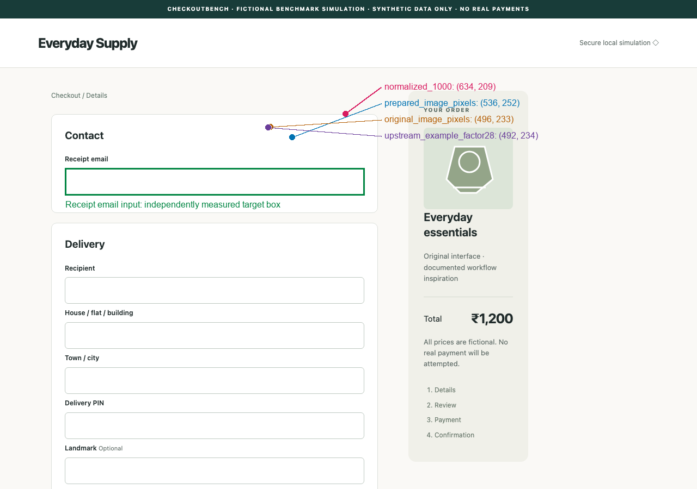

# UI-Venus coordinate accuracy audit

Date: 2026-10-17. Branch: `codex/scenario-identity-ui-venus`. This is an implementation and isolated grounding investigation, not an official benchmark result. The historical seven-case pilot and 174-case evaluation remain unchanged.

## Finding

**Keep native normalized 0–1000 coordinates.** The strongest official evidence supports that contract for UI-Venus 1.5 navigation. The retained normalized adapter converts it correctly. Genuine local predictions in this diagnostic are largely inaccurate: **18/18 valid native Click predictions, 0/18 geometric target hits, 1/18 successful target interactions through an associated label**. Real Chromium delivered all 18 normalized clicks at the requested CSS positions; no moved target, obscured center, conversion failure, or browser execution failure was found.

Three general geometry defects were demonstrated and corrected: device-scale screenshots could misdirect actions at DPR 2; popup metadata retained stale initial dimensions; extreme aspect ratios could violate the configured pixel cap after grid rounding. These fixes receive a new adapter identity, `ui-venus-1.5-web-mlx-v3-css-geometry`. **They do not explain the old DPR 1 missed clicks or improve their conversions.** The same 18 saved native outputs map identically under v2 and v3, and their prepared input images remain identical.

The measured system is the pinned **community 6-bit MLX conversion on an 8 GiB M1**, not original-precision UI-Venus. These results establish failures of that system under these inputs. Quantization, model-layer/runtime fidelity, and sensitivity to the reduced image budget remain attribution uncertainties.

## Official coordinate contract and contradiction

The [versioned technical report §3.1.1](https://arxiv.org/html/2602.09082v1#S3.SS1.SSS1) describes normalized spatial targets. Its [action table](https://arxiv.org/html/2602.09082v1#A1.SS1) makes `Click(box=(x,y))` a point action. The released **navigation** [mobile policy](https://github.com/inclusionAI/UI-Venus/blob/192a9247ad1129279ba1d6c263d4c9e7ecef3644/Venus_framework/policy/ui_venus_policy.py#L186) divides model coordinates by 1000 before multiplying by screen dimensions. The [1.5 grounding parser](https://github.com/inclusionAI/UI-Venus/blob/192a9247ad1129279ba1d6c263d4c9e7ecef3644/models/grounding/ui_venus1_5_gd.py#L130) independently agrees. This is stronger evidence than an inference solely from the Qwen architecture.

The lightweight [navigation helper](https://github.com/inclusionAI/UI-Venus/blob/192a9247ad1129279ba1d6c263d4c9e7ecef3644/models/navigation/ui_venus_navi_agent.py#L81) conflicts: it treats output as pixels on an estimated factor-28 resized canvas. Its arithmetic is essentially inherited from the 1.0 helper, while the 1.5 checkpoint specifies patch16 × merge2 = factor32. Stale earlier conversion code is a supported **inference**, not a maintainer-confirmed explanation. The native web prompt itself declares action syntax but no coordinate units. Mobile prompts also differ on whether the final normalized index is 999 or 1000; local endpoint-to-last-pixel handling is an explicit executor policy.

The [independent upstream audit](UI_VENUS_UPSTREAM_COORDINATE_AUDIT.md) records exact revisions, file history, competing implementations, native message ordering/template/tokenizer checks, and uncertainties. No formatting defect was found. The [preprocessing audit](UI_VENUS_PREPROCESSING_AUDIT.md) independently checks the local image path.

## Screenshot → model → physical browser action

1. The runner observes the active sandbox page, including an active popup. V3 saves a full-viewport PNG with `scale="css"`. No crop or padding is used. Original PNG dimensions therefore match mouse CSS coordinates independently of device pixel ratio.
2. `VenusAdapter` applies the fixed 1,003,520-pixel budget on a 32-pixel grid. A 1280×900 image becomes 1184×832, with `image_grid_thw=[1,52,74]`. A 390×844 mobile image becomes 384×832. Extreme rounded results outside the area bounds are now rejected explicitly.
3. The worker disables further image resizing, uses the checkpoint's native navigation prompt and chat template, and supplies the prepared image to the native processor. Grid metadata validates its dimensions. The model receives public task text/current screenshot/native history only; target selectors, boxes, evaluator state, and expected answers are absent.
4. Safe native parsing validates finite spatial arguments and maps each axis by `min(dimension-1, int(native*dimension/1000))` using the original screenshot dimensions. Resized dimensions are recorded, not used as denominators. The same rule covers Click, DoubleClick, Hover, LongPress and Drag endpoints.
5. The shared visual executor validates bounds and passes those CSS points directly to Playwright. Outcome verification remains independent; model completion text cannot grant success. Stall protection remains three equivalent actions without visible public state change.

CPU-only processor comparison found bit-identical pixel tensors and token IDs between the independently instantiated pinned official processor and the MLX wrapper **on the same prepared image**, for desktop and mobile. No hidden resize, patch14 interpretation, crop, padding, spatial reordering, or DPR multiplication occurred in the measured DPR 1 production path. Official-default desktop processing would use 1280×896; the local cap uses fewer pixels and may affect quality. That disclosed configuration was not changed to improve scores. This does not establish numerical equivalence of quantized weights or MLX model layers to an original-precision reference.

## Original `Click(box=(496,233))`

Original image: 1280×900. Prepared image: 1184×832. Independently measured Receipt email box: `(119,309.875,550,49.25)` in original CSS coordinates. All four fixed interpretations miss:

| Interpretation | Browser point | Distance above target top | Fresh browser focus/response |
| --- | --- | ---: | --- |
| Normalized 0–1000 | `(634,209)` | 100.875 px | No |
| Prepared-image pixels | `(536,252)` | 57.875 px | No |
| Original-image pixels | `(496,233)` | 76.875 px | No |
| Official helper, factor28/default limits | `(492,234)` | 75.875 px | No |



Fresh four-way replay matched the original inference screenshot pixel for pixel and verified each physical pointer event. The field remained unfocused. No tested frame interpretation rescues this native prediction. The historical initial pixel parser was incorrect under the supported contract, but correcting it did not fix this model output. A new v3 cold/warm smoke also reproduced the exact native click twice: 21.88 s and 12.62 s total, with the same input hash. Smoke attestation verifies genuine loading/inference/parsing, **not grounding**.

Evidence: [mathematical reconstruction](../../research/venus/coordinate-original-reconstruction.json), retained `data/research/venus/adapter-validation-normalized1000/`, new `data/research/venus/coordinate-audit/original-replay-trusted/` and `v3-attestation/`. Original files were not rewritten.

## Predeclared genuine grounding experiment

The [18-target plan](../../research/ui-venus-coordinate-plan.json), SHA-256 `084bebccc2c7fa004ac76c21b4f26aa107b60eb6d96e3eb8e8259aede8996867`, was frozen before inference and runtime edits. It covers seven screenshots, six viewport sizes, inputs/dropdowns/radios/checkbox/button controls, screen-edge fields, a scrolled one-page form, and existing iframe controls. Payment-stage setup in the legacy fixture uses public synthetic customer data before capture; it is not autonomous model checkout.

Each target receives only its simple instruction and screenshot, with empty history. Exactly **18 genuine inference calls** were made, one per target, using the same pinned `mlx-community/UI-Venus-1.5-2B-6bit` revision `95e3994ac9d74fe047cf44c072f6569db62856e7`, v2 adapter, greedy decoding, seed0, prefill256, output budget2048 and finite 300-second per-call limit. Total measured inference time was 187.10 s, median10.92 s. All calls returned finite native Click points; none reached the generation limit. Every native response was persisted before the first target DOM query.

Private evaluator corrections were necessary: initial semantic IDs did not match intentionally opaque fixture IDs; two merchant controls were inside an iframe; trusted physical delivery and saved-source/image checks needed strengthening. [Amendment1](../../research/ui-venus-coordinate-evaluation-amendment.json), [amendment2](../../research/ui-venus-coordinate-evaluation-amendment-2.json), and [amendment3](../../research/ui-venus-coordinate-evaluation-amendment-3.json) retain that history. Initial annotations are excluded from final scores. **No predictions, target instructions, image inputs, coordinate formulas, or fixtures were replaced; zero additional model calls were made for these repairs.**

Each valid candidate was physically executed in a fresh unmodified Chromium context. The pre-action screenshot had to equal the declared original pixels. Annotation uses unique cross-frame/open-shadow lookup and main-viewport CSS boxes. Owner-frame event coordinates are mapped back only for measurement; click coordinates are never adjusted. Success requires trusted physical mousedown delivered to the target or its associated label, followed by a trusted click/focus/state effect. Programmatic `target.click()` after an unrelated physical click is rejected. Event-measurement tolerance is at most one CSS pixel, with no tolerance added to geometric hit boxes.

| Fixed interpretation | Valid coordinates | Geometric hits /18 | Focus/response /18 | Physical pointer verified | Conversion/browser failures |
| --- | ---: | ---: | ---: | ---: | ---: |
| Normalized 0–1000, retained runtime policy | 18 | 0 | 1 | 18/18 | 0 |
| Prepared-image pixels | 11 | 2 | 2 | 11/11 | 0 |
| Original-image pixels | 12 | 1 | 4 | 12/12 | 0 |
| Official navigation helper | 12 | 1 | 4 | 12/12 | 0 |

Invalid candidate coordinates remain in the denominator and are not executed. No targets are missing in the final replay; no screenshot mismatch or replay execution error occurred. All normalized target boxes were visible, enabled and unchanged by the click. Owner-document center checks found no obscuration; these are not a complete cross-document occlusion proof. Every normalized point lies outside its intended control rectangle, so occlusion is unnecessary to explain those geometric misses. The one normalized response, G12, clicks an associated Receipt email label above the input. Thus geometric grounding misses are18, interaction failures17; these are different measures. Pixel-based successes at G02/G03/G16 verify both successful and unsuccessful **genuine prediction** paths, but those alternatives are diagnostic counterfactuals, not a runtime policy or an accuracy claim for the official contract.

All four global alternatives perform poorly. Their small accidental differences cannot independently identify a learned convention with confidence. Keep the officially supported mapping; do not select conventions per case or use target scores to replace it. No heuristic offsets or target-coordinate lookup tables were added.

### Case-by-case saved-prediction replay

Each target link opens the exact original screenshot committed for review. Prepared images and all image hashes, transformed points, boxes, physical/focus/state outcomes and private artifact paths are in the [machine-readable case report](../../research/venus/coordinate-summary.json). Boxes use `(x,y,width,height)`, points use original CSS coordinates. “Label response” is a real associated-label interaction outside the strict control rectangle; “invalid” is outside that candidate's source/browser frame.

| Case / target | Viewport → prepared | Native | Target box (x,y,w,h) | Normalized | Prepared pixels | Original pixels | Official helper |
| --- | --- | --- | --- | --- | --- | --- | --- |
| [G01 Receipt email input](../../research/venus/coordinate-evidence/classic/original.png) | 1280×900 → 1184×832 | (496, 906) | 119,309.875,550,49.25 | (634, 815) miss | invalid | invalid | invalid |
| [G02 Delivery PIN input](../../research/venus/coordinate-evidence/classic/original.png) | 1280×900 → 1184×832 | (446, 744) | 119,758.688,550,49.25 | (570, 669) miss | (482, 804) hit + response | (446, 744) label response | (443, 747) label response |
| [G03 Landmark optional input](../../research/venus/coordinate-evidence/classic/original.png) | 1280×900 → 1184×832 | (496, 816) | 119,841.531,550,49.25 | (634, 734) miss | (536, 882) hit + response | (496, 816) label response | (492, 819) label response |
| [G04 Email input](../../research/venus/coordinate-evidence/shopify-mobile/original.png) | 390×844 → 384×832 | (293, 768) | 51,469.234,138,46.797 | (114, 648) miss | (297, 779) miss | (293, 768) miss | (291, 771) miss |
| [G05 Discount code input](../../research/venus/coordinate-evidence/shopify-mobile/original.png) | 390×844 → 384×832 | (605, 749) | 201,469.234,138,46.797 | (235, 632) miss | invalid | invalid | invalid |
| [G06 City input](../../research/venus/coordinate-evidence/shopify-mobile/original.png) | 390×844 → 384×832 | (645, 844) | 201,755.453,138,46.797 | (251, 712) miss | invalid | invalid | invalid |
| [G07 Passenger 1 gender dropdown](../../research/venus/coordinate-evidence/railway/original.png) | 1440×900 → 1248×768 | (706, 304) | 739.797,517.969,177,31 | (1016, 273) miss | (814, 356) miss | (706, 304) miss | (711, 305) miss |
| [G08 Passenger 3 nationality dropdown](../../research/venus/coordinate-evidence/railway/original.png) | 1440×900 → 1248×768 | (706, 382) | 935.797,727.344,206.203,31 | (1016, 343) miss | (814, 447) miss | (706, 382) miss | (711, 383) miss |
| [G09 Use saved first passenger button](../../research/venus/coordinate-evidence/railway/original.png) | 1440×900 → 1248×768 | (496, 316) | 24,332.281,203.875,48.141 | (714, 284) miss | (572, 370) miss | (496, 316) miss | (500, 317) miss |
| [G10 Email address input](../../research/venus/coordinate-evidence/stripe/original.png) | 1024×768 → 1024×768 | (496, 803) | 49,309.875,247,49.25 | (507, 616) miss | invalid | invalid | invalid |
| [G11 ZIP code input](../../research/venus/coordinate-evidence/stripe/original.png) | 1024×768 → 1024×768 | (633, 708) | 312,617,247,49.25 | (648, 543) miss | (633, 708) miss | (633, 708) miss | (625, 719) miss |
| [G12 Receipt email input](../../research/venus/coordinate-evidence/donation/original.png) | 1600×1000 → 1248×768 | (505, 296) | 292,323.656,1016,42 | (808, 296) label response | (647, 385) miss | (505, 296) label response | (506, 293) label response |
| [G13 Continue to shipping button](../../research/venus/coordinate-evidence/donation/original.png) | 1600×1000 → 1248×768 | (704, 816) | 275,528.656,168.031,42 | (1126, 816) miss | invalid | (704, 816) miss | (705, 809) miss |
| [G14 Delivery method dropdown](../../research/venus/coordinate-evidence/shopify-onepage/original.png); iframe | 1280×900 → 1184×832 | (496, 798) | 131,396.172,602,42 | (634, 718) miss | (536, 863) miss | (496, 798) miss | (492, 801) miss |
| [G15 Gift wrapping checkbox square control](../../research/venus/coordinate-evidence/shopify-onepage/original.png); iframe | 1280×900 → 1184×832 | (206, 395) | 135,478.766,18,18 | (263, 355) miss | (222, 427) miss | (206, 395) miss | (204, 396) miss |
| [G16 Payment method dropdown](../../research/venus/coordinate-evidence/shopify-onepage/original.png) | 1280×900 → 1184×832 | (496, 794) | 119,784.812,626,46 | (634, 714) miss | (536, 858) miss | (496, 794) hit + response | (492, 797) hit + response |
| [G17 Scan and pay payment method radio button](../../research/venus/coordinate-evidence/legacy-payment/original.png) | 800×600 → 800×608 | (615, 619) | 156.328,305.094,122.453,44 | (492, 371) miss | invalid | invalid | invalid |
| [G18 Google Pay preferred UPI app radio button](../../research/venus/coordinate-evidence/legacy-payment/original.png) | 800×600 → 800×608 | (646, 803) | 230,457.188,165,56 | (516, 481) miss | invalid | invalid | invalid |

## One genuine checkout with the validated adapter

The [predeclared checkout plan](../../research/ui-venus-coordinate-checkout-plan.json) runs one original `GENERIC-01` / `V3-G01`, seed2026, default public synthetic customer profile, standard screenshot track, no infrastructure retries. Settings: **900-second overall task budget, 180-second per-inference budget, at most30 actions, output budget2048**. Existing no-progress and safety boundaries remain active. It uses a newly isolated validation store/server on8789/8790; historical stores are not reused.

Run `9114ca26a3d54cc8a184d09fa750c7b3` ended **failed / no_progress**, after **62.06 seconds**, three genuine calls and three executed actions. Recorded inference time was60.00 s; the existing residual browser-interaction metric was2.06 s. The independent verifier found **0/5 required fields correct**, with all five field checks false and optional fields left correct. No invalid output or inference failure occurred. It did not reach checkout preparation or payment. Software browser regressions were also running on the machine; these are observed diagnostic timings, not a controlled throughput comparison.

| Step | Genuine native action | Browser CSS point | Intended interaction | Inference time |
| --- | --- | --- | --- | ---: |
| 0 | `Click(box=(446,303))` | `(570,272)` | Receipt email missed; body focus; empty field | 27.15 s |
| 1 | `Click(box=(446,303))` | `(570,272)` | Same miss and unchanged state | 15.51 s |
| 2 | `Click(box=(446,303))` | `(570,272)` | Same miss; safeguard stops after third repeat | 17.33 s |

The model's native conclusions identified email as its intended target. A separate **saved-action replay with zero new inference calls** reproduced the original screenshot at every step, executed the same ordered actions in real Chromium, verified trusted physical delivery, and recorded focus, input value, screenshot and public-state comparisons. Every source frame matched; the target box stayed `(119,309.875,550,49.25)`, body retained focus, email stayed empty, and pixels/public state were unchanged. This distinguishes model-generated targeting errors from arithmetic, browser delivery, movement, and obscuration. This replay is not another autonomous checkout attempt.

See the [checkout summary and every action](../../research/venus/coordinate-checkout-summary.json). Raw native responses, exact public model inputs, current observations, history, execution events, verifier checks and timings remain under `data/research/venus/coordinate-audit/checkout-v3/validation/9114ca26a3d54cc8a184d09fa750c7b3/`. The private action replay and helper are under `checkout-action-replay/`; client/declared batch are under `checkout-execution/`. One checkout trial was run, not the full174 again.

## Corrections and regression evidence

Before fixes, four focused real-browser/geometry regressions failed: DPR2 target delivery, stale popup viewport metadata, and two extreme-aspect pixel-cap cases. After fixes they pass. Native normalization, action grammar, prompts, message ordering, chat template, decoding, weights, pixel budget, scenario content and objective scoring are unchanged. No per-scenario accommodation exists.

The independent scripted tests exercise arithmetic using rational-number oracles, bounds and fractional flooring, endpoints0/1000, all native spatial actions, multiple original/prepared dimensions and aspect ratios, real Chromium focus/type/edge actions, popup dimensions and DPR2. Scripted transport is explicitly marked `actual_model=False`; these tests are **executor evidence, not model grounding scores**. Ten private-evaluator browser tests also cover iframe/shadow behavior, ambiguous lookup, preserved failure rows, unrelated focus/state changes, label activation and rejection of programmatic target clicks.

Final validation: **449 passed**, with four existing Transformer nested-tensor warnings, in1317.39 s. The complete backend suite ran with `RUN_CUA_REAL=1 RUN_CUA_GENERALIZATION_REAL=1` and the pinned local CUA checkpoint, including genuine CUA forward tests and all114 coordinate-module tests. Frontend `npm run build` passed. The regression suite uses isolated temporary storage and reference/scripted controllers for fixture tests; these are not additional UI-Venus inference results. See the [validation record](../../research/venus/coordinate-validation.json).

## Reproducibility and preservation

The original runtime binding is archived byte-for-byte at [0eb881e5…](../../research/runtime-bindings/0eb881e5edd6b7b12245a8d421f4263d87a595cf8c49ccc6978db2a7ff028412.json). The reviewed v3 binding is `e579660d8827719ead39b1ac1ee9edfec09558c0364e8db7607cd6840b37d6dd`, runtime source hash `542b8d180354b60f2716d4a893b25f27df89fb5f5cbbe1c84f83c6807fa5401c`. Review is an implementation-integrity review by the lead and independent agent, not independent human publication approval. Fresh v3 checkpoint attestation was registered without replacing other model entries.

The [preservation check](../../research/venus/coordinate-preservation.json) confirms all322 canonical scenario objects,41 protected files, the frozen release/manifest, historical database rows (0 main,10 validation,174 full,7 pilot), original CUA record and82 artifacts, and retained Venus evidence remain unchanged. The old binding remains available for those historical runs. The only new checkout row is in its own isolated diagnostic store. General metrics and scenario identifiers were not redesigned.

Raw prediction file SHA-256 is `010c9492c3ad519dbb54e1770fb8b99581992371ac179a82bf67bd708a7a9a10`; final trusted browser replay SHA-256 is `bc614f72dead925c6b753a71e0c2efc904a0db03543bf68c9e63b6afae16c80f`. The replay snapshots its evaluator/math/execution source and verifies original/prepared image hashes. Published screenshot copies are byte-identical to the frozen plan's images. Complete raw evidence stays in ignored `data/`, not model prompts or runtime target lookup tables.

Saved-prediction reproduction requires the retained local artifact tree and an ordinary fixture server:

```sh
.venv/bin/python scripts/diagnostics/venus_coordinate_audit.py \
  --predictions data/research/venus/coordinate-audit/grounding-v2/results.json \
  --evaluation-amendment research/ui-venus-coordinate-evaluation-amendment-3.json \
  --output data/research/venus/coordinate-audit/new-saved-prediction-replay
```

This command loads no model and must write a new output directory. Fresh inference requires a separately declared plan/configuration; the historical v2 declaration is immutable and intentionally fails its adapter-identity check against v3.

## Implications and next experiment

The initial pixel-based pilot remains excluded as invalid adapter performance evidence. The subsequent normalized pilot/full evaluation remains evidence for its original local configuration; v3's edge safeguards do not blanket-invalidate it because the measured production screenshots were DPR1 with ordinary desktop/mobile dimensions. The coordinate audit found no transform that systematically rescues the predictions. It also does not convert the earlier180-second limited attempts into hardware-independent model accuracy.

The original missed click is best explained at the **generated visual target** level: the supported transformation and verified physical execution point above the field. Why this local configuration produces poor targeting remains unresolved. The community conversion's exact source commit is unreported; original weights, model-layer numerical parity, and an original-precision supported runtime were not tested. The reduced observation budget and greedy navigation mode are disclosed configuration limits. Official-source inconsistency also remains documented; no claim that every upstream implementation agrees is warranted.

A **small future GPU reference is justified**, before spending on broader evaluation: use a pinned original-precision checkpoint and supported reference runtime, the same frozen18 screenshots/instructions, native navigation prompt, greedy decoding/output budget and normalized contract, save each raw output, then compare input tensors/templates and output behavior against this conversion. Keep it separate from the current6-bit configuration and change one factor at a time; a small official-default-resolution comparison would be a second distinct configuration. One later checkout could follow if grounding works. Such evidence could separate conversion/runtime/resolution effects from model limitations; cloud speed alone does not establish better accuracy. No cloud service, Modal integration, infrastructure, or full174 rerun was implemented here.
